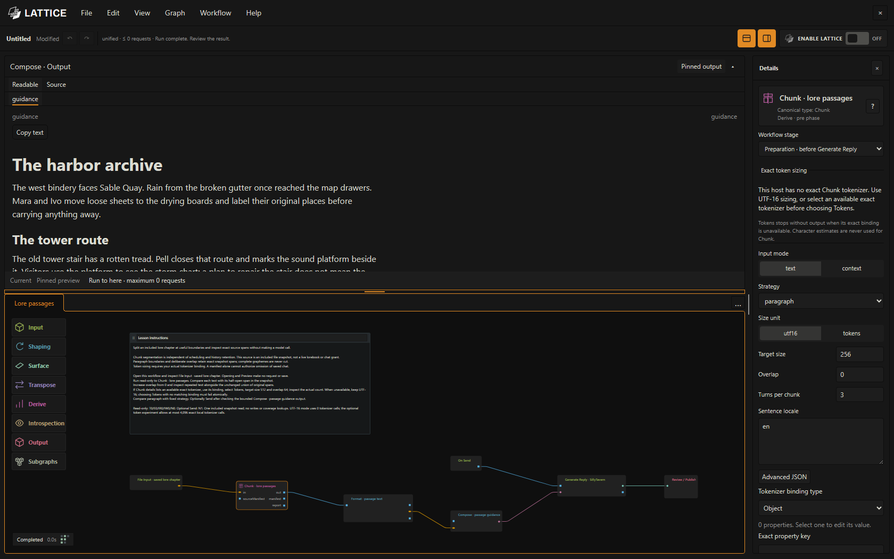
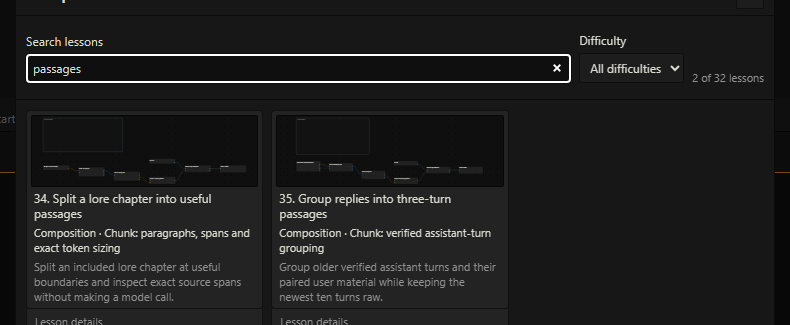

# Lattice 0.28.0

## A chapter, a conversation, a few useful passages

A lore sheet can hold a whole world, but you may only want to work with a few paragraphs at a time. An older conversation can be easier to revisit as a series of small exchanges.

Lattice now includes **Chunk**, a tool for dividing supplied material into passages you can inspect and use in a workflow. Choose a passage size, allow neighboring passages to share a little text when useful, and look at the result before it reaches your next reply.

Your usual SillyTavern model still writes the reply, and you still decide whether to accept the reviewed result.

## Two new lessons to try

Open **File → Open examples…**. There are now **32 editable lessons**, including these two:

- **Split a lore chapter into useful passages.** Start with the included harbor chapter. Change the size and overlap, run the preparation again, and compare the passages. This is the easiest place to begin.
- **Group replies into three-turn passages.** Import the supplied practice chat into a disposable chat, set up its sources explicitly, and group older exchanges while keeping the newest turns together. The lesson explains each step.

Each lesson opens as your own editable copy. Save it, reopen it, or export it to share. The original 30 lessons remain available. The new lessons keep their existing numbers, 34 and 35, so the numbering has a gap.

## Start with the chapter lesson

1. Open **Split a lore chapter into useful passages** from the examples browser.
2. Select **Chunk** on the canvas. Its settings appear in **Details**.
3. Choose **Run to here** in Preview to prepare the passages. Look through the result, change a setting, and try again.
4. Use **Save As…** when you want to keep your version. If you enable the workflow and send a message normally, the lesson can use its prepared passages to guide that reply.

Passage preparation makes no extra model requests. Sending a message still uses your usual model and its normal cost. See the [passage lesson guide](../examples.md#foundation-passage-lessons) for the practice-chat setup and expected results.

## Your conversation stays intact

These lessons leave the original chat history in place. Grouping older exchanges does not replace those messages with a summary or remove them from SillyTavern.

The conversation lesson asks you to **Set up chat sources** before reading verified older exchanges. Opening the lesson does not perform that setup automatically. After reopening the chat, use **Verify saved sources**; the lesson explains when reconciliation is needed after an edit.

This release does not add an automatic background memory worker, a new search-and-indexing system, or Summaryception. Existing supported Recall and search remain available. The broader memory work is being kept for later, smaller releases.

## Install or update

In SillyTavern, open **Extensions → Install extension**, enter `https://github.com/MentallyQuill/Lattice`, leave the branch blank, and reload after installation.

If you already use Lattice, save your workflows, update through **Manage Extensions**, and reload SillyTavern. Try the new examples in a separate practice chat first. There is no need to rebuild your existing workflows to try the new lessons.

The release ZIP includes the compiled extension, examples, manuals, and license information. You do not need to build it yourself. A checksum file is supplied with the download. The [quick start](../lattice-workspace.md) covers your first reply, and the [operator's manual](../operators-manual.md) explains the editor.

## A few things to know

- **Lattice remains in beta.** The release was checked with SillyTavern 1.19.0 using fictional practice material. Other host versions and model providers may behave differently.
- **Use the default text-length sizing to start.** Exact token sizing needs a matching tokenizer supplied by the host. When one is unavailable, Lattice tells you; it does not quietly guess a token count.
- **Portable files leave out local connections and credentials.** After importing a shared workflow, choose your own model connections and authorize any story documents it needs.
- **Small practice examples are not a speed promise for a large story system.** Total reply time also depends on your workflow and model.

The release checks covered both new lessons, editing and file roundtrips, source handling, and reply review. Final reply-flow checks used a previously captured model response. The [technical release report](../superpowers/reports/2026-10-21-foundation-release.md) records the verification and its limits.

If something goes wrong, [open an issue](https://github.com/MentallyQuill/Lattice/issues) with your Lattice and SillyTavern versions, what you were trying to do, and the steps that led to the problem. Keep private chat material and credentials out of the report.
